# ZZUAE — Amiga OCS/ECS Emulation on ZZ9000

**Latest release: 0.5.6 Beta · App version: 0.5.6-dev**

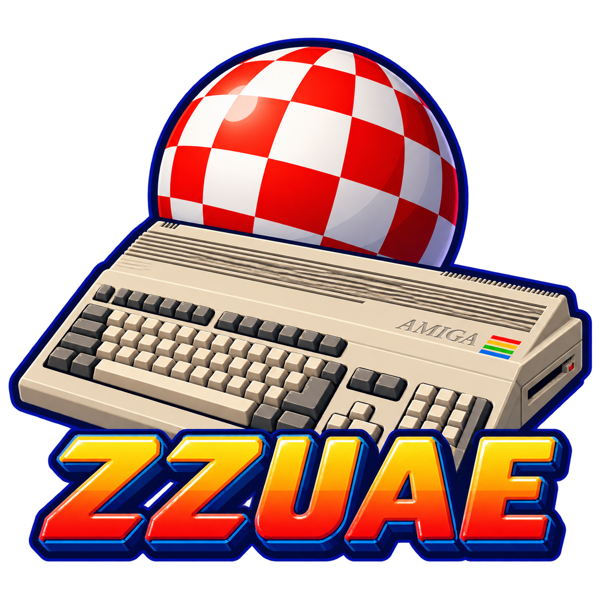

Amiga emulation on the ZZ9000 Cortex-A9, with a native AmigaOS MUI launcher.
Based on [Chips-fr/UAE4ARM](https://github.com/Chips-fr/uae4arm-rpi), using
[Xanxi’s XACP framework](https://github.com/Xanxi-Amiga/XACP-ZZ9000) for the
68K/ARM execution model.

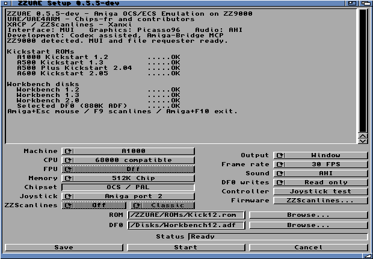

## Download and install

[Download the development Beta](https://github.com/SkiltonUSA/ZZUAE-ARM-68K/releases/tag/v0.5.6-beta).
Choose the **AmiPkg LHA** for guided offline installation or the **ZIP** for manual
copying. Extract the installer, open its drawer and double-click **Install**.
Both include Xanxi’s scanline tools; supply your own ROMs and disks.
[Installation and dependency checks](docs/amiga-uae4arm-installer.md).

### Run from Shell

From the installed ZZUAE drawer:

```text
Stack 131072
ZZUAE
```

For testing:

```text
Stack 131072
ZZUAE -test
```

`-test` enables frame limits, capture controls, the FPS counter and borders.
**F5** captures a screenshot. Select the machine, ROM and disk, then **Start**.

## New in 0.5.6 Beta

Documented and resolved the reported Rick Dangerous pauses by removing obsolete
RAM-disk test files. Background disk-usage queries had delayed host servicing;
windowed and fullscreen repeats now have **zero gaps over 100 ms**. Gameplay
confirmation passed. [Findings and cleanup guidance](docs/amiga-uae4arm-ram-disk-stall.md).

This maintenance release refreshes the packages and documentation. Emulation
algorithms are unchanged; the installer does not automatically clean RAM:.

**Benchmark status:** earlier hardware timings and percentage gains below may
include background RAM-disk stalls and need controlled remeasurement. They are
historical results, not clean measurements of optimisation gains. Frontier and
State of the Art also feel faster after cleanup; new FPS figures are pending.

## Previous update: 0.5.5 Beta

The optional JIT player combines register grouping, earlier drawing/audio-pressure
selection and batched exception setup. Alien Syndrome's 3,000-frame window/AHI
run improved **75.95 → 69.99 seconds (+8.52%)** against the earlier corrected JIT
baseline. Guest state and PCM totals matched. This is throughput, not gameplay FPS.

The JIT and optional FPU players use a **32 MiB translation cache / 64 MiB runtime**.
Compatible 68000 remains the default. Audio gaps and the earlier long-run timeout
remain unresolved. [Measurements, build flags and validation](docs/amiga-uae4arm-jit-batch.md).

The final Beta also adds DF1 and independent read lights. The optimisation timings
above were recorded before those additions. Final feature-build validation took
74.74 seconds for the same 3,000-frame Alien Syndrome window/AHI check; audio gaps
remain. [Two-drive verification](docs/amiga-uae4arm-df1.md).

## Features

- A1000, A500, A500 Plus and A600 profiles, with matching OCS/ECS and memory settings.
- 68000 emulation on Cortex-A9; Copper, Blitter, CIA, floppy and Paula emulation.
- Per-machine Kickstart selection and ADF loading.
- Startup checks for Kickstart and Workbench disks, with OK / MISSING / INVALID status.
- 4:3 Workbench window, up to 640 × 480 and fitted to smaller screens, with an ARM-written Picasso96 bitmap.
- 25, 30, 50 or MAX FPS display choices; audio-paced PAL guest timing when sound is on.
- Paula direct, AHI stereo, or sound Off.
- Keyboard, mouse and Amiga port-2 joystick input; three guest fire buttons.
- Joystick tester, saved settings, startup/error log and cooperative Stop/Amiga+F10 exit.
- Read-only disks or temporary writes to an in-memory copy.
- Test-only F5 screenshot capture to BMP; fullscreen F9 cycles Xanxi ZZScanlines; Amiga+F10 exits.
- Bundled Xanxi ZZScanlines firmware utility, with an install-missing helper.
- Saved ZZScanlines On/Off switch with Classic, Soft and Gradient styles for PAL fullscreen. No software scanlines in windows.
- Guarded NEON pixel conversion at 640-pixel width; scalar fallback for smaller windows.
- Matching colour Workbench icon and opening/loading splash screens with shortcuts.

### Display and controls

- Window, Fullscreen PAL or Fullscreen HiRes.
- Window status lights: green running, then independent red DF0 and DF1 read lights.
- Optional real-time clock, initialised from AmigaOS time; host clock remains untouched.
- Optional DF1 ADF slot with Browse/Eject and saved selection; select disks before Start.
- Mouse capture: click or **Amiga+Esc**; release: **Amiga+Esc**; exit: **Amiga+F10**. [Mouse and HiRes details](docs/amiga-uae4arm-mouse.md).
- PAL 320 × 256 for games; **Fullscreen HiRes 640 × 512** for sharper text; 4:3 scaling in window mode.
- Test-only **ZZ9000 FPS** counter and decorative border. The counter measures completed display presentations.
- `-test` exposes bounded runs, F5 capture, FPS and border; normal play forwards F5 to the guest.
- Optional **68882 (experimental)** guest FPU in accelerated 68020 modes, backed by Cortex-A9 VFP. [Details and precision limits](docs/amiga-uae4arm-fpu.md).
- Workbench display preferences remain unchanged.

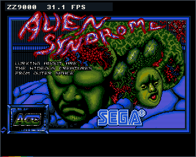

The ZIP and AmiPkg installer include these features.
[Display settings](docs/amiga-uae4arm-launcher.md) · [Implementation and validation](docs/amiga-uae4arm-presentation.md).

[Amiberry, FS-UAE and Retro-Amiga source review](docs/amiga-uae4arm-amiberry-fsuae-review.md):
ARM32 JIT opportunities, platform constraints and interface ideas. No code from
these projects was imported by this update.

## Requirements

| Component | Requirement |
|---|---|
| Amiga | AmigaOS 3.x; 68020-compatible host executable |
| ZZ9000 | XX19c/XACP runtime used by this prototype; available application Core1 |
| Memory | 32 MiB available ZZ9000 RAM for compatible 68000; 64 MiB for experimental 68020/JIT/FPU, plus OS/UI headroom |
| Display | Picasso96 and a supported 32-bit RTG Workbench for direct window rendering |
| Launcher | MUI 3.8 or later |
| Joystick | lowlevel.library V40; available buttons depend on controller reports |
| Sound | AHI unit 0 for AHI output; native audio.device for Paula direct |
| Media | Matching Kickstart ROM and Workbench/game disk images supplied separately |

Development has been tested on an A4000TX with TF4060. The TF4060 is the tested
configuration, not a hard-coded requirement; slower host CPUs remain unmeasured.
Only one application may use Core1 at a time.

## Screenshots

Captured on the physical A4000TX/ZZ9000, with native FinalWriter running beside
ZZUAE. Badlands shows its **demo race**; Alien Syndrome shows its **title screen**.
These historical 0.5.3 comparisons use the former software scanlines inside the game window.
0.5.4 uses FPGA scanlines exclusively; their effect cannot be captured in a framebuffer screenshot. Click an image
for the full-size Workbench capture.

| Game | Scanlines Off | Soft scanlines |
|---|---|---|
| Badlands — demo race | 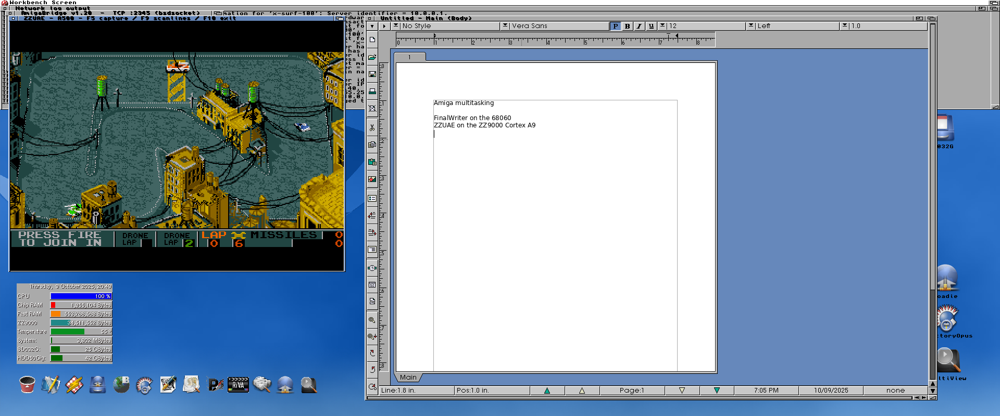 | 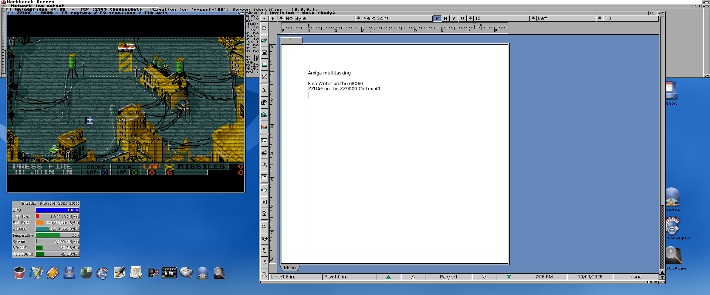 |
| Alien Syndrome — title | 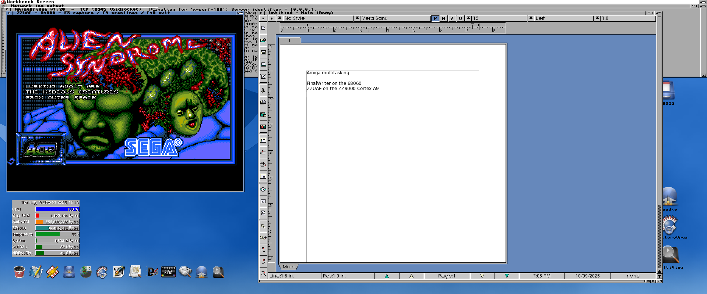 | 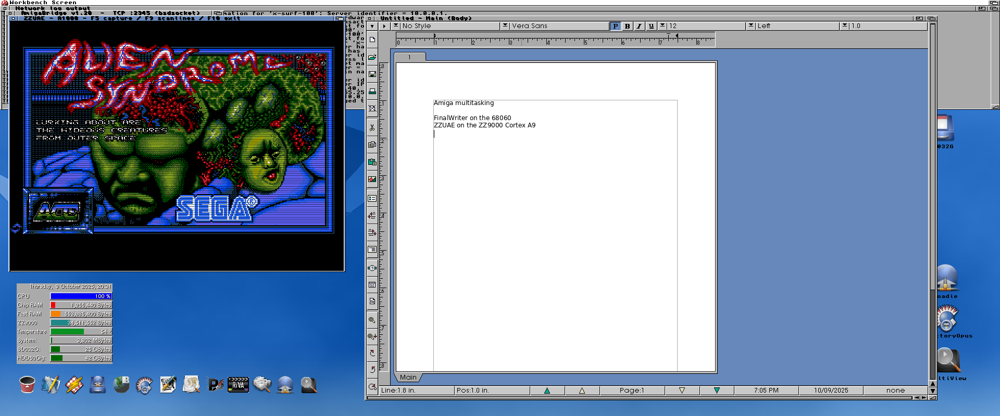 |

### Startup and loading

| Opening splash | Loading splash |
|---|---|
| 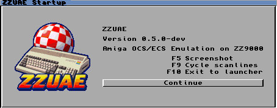 | 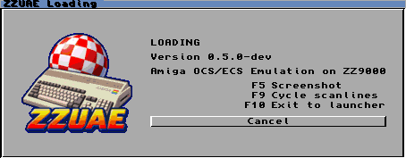 |

### Three-button joystick tester

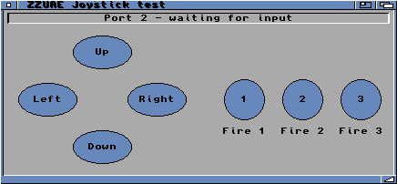

### Workbench 2.0 in the A500 Plus profile

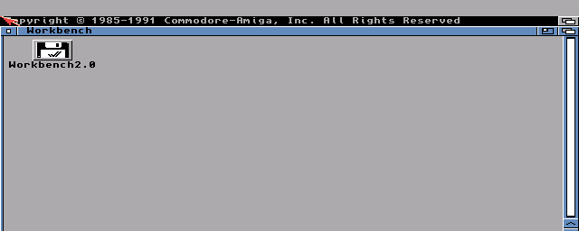

## Optimisation results

### Development: 32 MiB JIT cache

Repeated Alien Syndrome startup tests improved **66.14 → 68.87 emulated FPS
(+4.12%)** with a 32 MiB translation cache. This experimental JIT build requires
**64 MiB of free ZZ9000 RAM** for its runtime allocation and is included in the
experimental 0.5.5 players. The slower guarded direct-RAM path remains disabled.
The initial cache experiment diverged in Frontier; the subsequent timing fix
resolved that recorded endpoint mismatch.
[Implementation, measurements and limits](docs/amiga-uae4arm-direct-ram.md).

**JIT timing diagnostic:** both cache sizes now match the interpreter's cycle
count, final PC and frame hash in a 3,000-frame Frontier hardware test. The
isolated mode fixes instruction/event timing and bounds JIT metadata, but is
slower than the interpreter. It is not the installed or released default.
[Causes, tests and measured results](docs/amiga-uae4arm-jit-timing.md).

**ARM constant loading:** using MOVW/MOVT instead of literal loads improved the
same Frontier diagnostic from **58.95 → 58.27 seconds (+1.17% throughput)**.
Two runs per variant matched guest cycles, final PC and frame hash. This remains
an execution-time measurement, not gameplay FPS; 0.5.5 includes this technique.
[Tests and results](docs/amiga-uae4arm-jit-constants.md).


### Development: event-bounded JIT and A9 bitfields

New isolated tests combine register-only instruction groups, chipset-event
budget checks, a shared metadata lookup and the Cortex-A9’s A32 bitfield emitter.
Two headless hardware runs per build give these changes against the
instruction-sized MOVW/MOVT JIT reference:

| Workload | Reference | Combined changes | Throughput gain |
| --- | ---: | ---: | ---: |
| Frontier intro, 3,000 guest frames | 58.33 s | 56.76 s | +2.77% |
| Alien Syndrome startup, 1,800 guest frames | 33.24 s | 32.91 s | +0.99% |
| A600 Workbench 2.0 boot, 1,800 guest frames | 22.74 s | 22.62 s | +0.53% |

Final guest cycles, PC and frame hashes matched. These are execution-time
measurements, not gameplay FPS. The corrected JIT remains slower than the interpreter on all three workloads;
these earlier results preceded the combined 0.5.5 build.
[Implementation, failed candidates and test results](docs/amiga-uae4arm-jit-events.md)
· [Z3660-AMIX review](docs/amiga-uae4arm-z3660-review.md).


### Development: precomputed JIT opcode classification

Resolving opcode aliases once during CPU setup removes repeated lookups from
the execution loop. Two matched headless hardware runs per build measured:

| Workload | Grouped JIT | Precomputed map | Throughput gain |
| --- | ---: | ---: | ---: |
| Frontier intro, 3,000 guest frames | 56.76 s | 54.43 s | +4.29% |
| Alien Syndrome startup, 1,800 guest frames | 32.92 s | 31.57 s | +4.30% |
| A600 Workbench 2.0 boot, 1,800 guest frames | 22.64 s | 21.72 s | +4.24% |

Guest results matched, with clean shutdowns. A bounded windowed AHI run also
improved **3.69%**; audio queue gaps remain. This remains an opt-in JIT
experiment; these figures are not gameplay FPS, and the corrected JIT still
trails the interpreter. These earlier measurements preceded the 0.5.5 combined build.
[Profiling, implementation and test evidence](docs/amiga-uae4arm-jit-profile.md).

### Development: register groups and audio scheduling

Expanding safe register-only JIT groups improved measured throughput by
**1.99% in Frontier**, **3.43% in Alien Syndrome**, and **3.10% in the live
window/AHI Alien Syndrome test**. Workbench changed by only 0.29%.
Guest cycles, final pixels and CPU state matched the reference.

A separate experiment skips audio-pressure frames before drawing: **1.80%**
faster in the same live workload. These gains are separate, not additive.
The earlier register-group build hit the 150-second deadline in its 6,000-frame
live test. That long-run gate has not been repeated for 0.5.5; stable audio is
not established. The combined changes are now in the optional Beta players.
[Service profiling, measurements and validation](docs/amiga-uae4arm-jit-service.md).

### 0.5.4 update

State of the Art now benefits from selecting display frames **before pixel
drawing**, keeping CPU/chipset/Paula execution intact. Two matched runs per
build at a 30 FPS cap improved average displayed FPS **18.46 → 19.74 (+6.93%)**.
Guest instruction/cycle counts, audio-sample counts and final pixels matched;
late audio-queue observations decreased. New settings default to
30 FPS, though this demo does not sustain that target: a longer windowed run
including heavier sections averaged 12.05 displayed FPS. The experimental NEON
bitplane converter was slower and remains disabled.
[Results, profiling and test evidence](docs/amiga-uae4arm-state-of-art.md).


Normal play now offers **Window / Fullscreen** and runs until stopped. Diagnostic
frame limits and capture controls are available through `ZZUAE -test`, or icon
ToolType `TEST=YES`. F9 changes fullscreen ZZScanlines and Amiga+F10 exits; F5 capture is test-only.
Fullscreen offers PAL 320 × 256 or HiRes 640 × 512 without saving Workbench display
settings. [Display options and verification](docs/amiga-uae4arm-display-testing.md).

An earlier 0.5.4 development build added about **5.3%** more startup throughput over 0.5.3:
**49.38 → 52.01 emulated FPS** with Soft scanlines in a matched Alien Syndrome run.
Audio-aware presentation reduced late queue observations **411 → 1** in a longer
run, by deferring **15% of display updates** while preserving guest CPU and PCM
results. Listening acceptance remains pending.

A600 / Workbench 2.0 desktop boots passed with both supplied Kickstart 2.05
revisions. [Audio/NEON results and evidence](docs/amiga-uae4arm-054.md).

The launcher offers **68000 compatible**, **68020 JIT
(experimental)** and a matching **68020 interpreter (test)**. The compatible
68000 player remains the default. The separate ZZUAE-FPU player provides an
optional experimental 68882; FPU instructions use the VFP-backed interpreter
rather than FPU JIT translation. The JIT port corrects
byte-register moves and validates modified RAM code before dispatch.

An earlier 512 KiB-cache comparison showed **no meaningful JIT gain over the
68020 interpreter**:

| Presentation | 68020 interpreter | 68020 JIT |
|---|---:|---:|
| Direct window, Soft scanlines | 49.00 emulated FPS | 48.76 emulated FPS |
| No live window | 68.97 emulated FPS | 69.03 emulated FPS |

These are single 1,800-frame startup comparisons, not sustained gameplay FPS.
The corrected core passes the documented endpoint comparisons, but long-run
audio and broader compatibility remain unresolved. Use **68000 compatible**
for normal play.
[JIT integration, correctness fixes and test evidence](docs/amiga-uae4arm-jit-player.md).
The Beta includes the experimental JIT/FPU players; **68000 compatible** remains the default.

The optional **68882 FPU** uses Cortex-A9 VFP through the interpreter fallback.
Physical arithmetic/rounding tests passed, with complete ARM floating-point
state restoration. It uses double precision rather than full 68882 extended
precision. The supplied Frontier intro ran successfully but recorded **zero FPU
data operations**; its state-save activity is not evidence of FPU acceleration.
[FPU setup, tests and limits](docs/amiga-uae4arm-fpu.md).

### NEON renderer (0.5.3)

Matched 1,800-frame Alien Syndrome startup runs, Direct 640 × 480, audio Off
and MAX frame rate on the A4000TX/ZZ9000:

| Scanlines | Scalar baseline | NEON | Throughput gain |
|---|---:|---:|---:|
| Off | 45.02 emulated FPS | 49.39 emulated FPS | +9.7% |
| Soft | 42.62 emulated FPS | 49.48 emulated FPS | +16.1% |

Guest instruction counts, cycles, final PC and frame hash matched. These measure
startup/title emulation throughput, not sustained gameplay FPS. Off uses the
mean elapsed time of two NEON runs.

With AHI audio and a 25 FPS display cap, a separate 3,000-frame run fell from
63.24 to 60.60 seconds; late audio-queue observations fell from 334 to 34.
PCM delivery completed without device errors; listening acceptance remains pending.
The assembly preserves SIMD state, with scalar fallback when NEON is unavailable.
[Full measurements, stage profiling, validation and JIT investigation](docs/amiga-uae4arm-neon.md).

### Earlier interpreter and renderer work (0.5.2)

Matched 1,800-frame Alien Syndrome startup runs on the A4000TX/ZZ9000,
640 × 480 Direct window, audio Off, scanlines Off and MAX frame rate:

| Build | Mean emulated FPS | Gain over baseline |
|---|---:|---:|
| 0.5.1 baseline | 29.17 | — |
| Batched interpreter exception context | 30.24 | +3.69% |
| Plus cached converted rows and specialised pixel loops (0.5.2) | 44.99 | +54.24% |

Guest instructions, cycles, final PC and frame hash matched. These are uncapped
startup measurements, not gameplay FPS or a promise of full-speed compatibility.
That earlier pass added no JIT, NEON or VFP; NEON was introduced in 0.5.3. [Method, audio results and validation](docs/amiga-uae4arm-optimisation.md).

## Current Beta Status

State of the Art still has a reported slowdown in the coloured-tile dancer
section. Copper/colour-span drawing is a profiling candidate, not a confirmed
cause. [Investigation status](docs/amiga-uae4arm-ram-disk-stall.md#remaining-scene-specific-slowdown).

A1000, A500, A500 Plus and A600 desktop boot checks passed on hardware.
A600 tests used Kickstart 37.350 with 1 MiB and 37.300 with 2 MiB Chip RAM,
plus Workbench 2.0. General A600 game/peripheral compatibility remains pending.
The A1000 profile
uses a preloaded ROM rather than the original disk-bootstrap sequence.

Disk swapping, persistent disk writes and IDE/PCMCIA media remain unfinished.
Audio queue gaps are still being investigated; listening and physical joystick
acceptance remain pending. With sound Off, current frame caps also slow guest time.
NEON accelerates the 640-pixel display path. The experimental JIT player
emulates a 68020 and has passed bounded game and Workbench boot checks; wider
compatibility and self-modifying-code coverage remain unfinished. Guest FPU is optional and experimental, using double precision rather than full
68882 extended precision. The Beta defaults to the compatible 68000 interpreter.

ZZScanlines requires compatible FPGA firmware and a supported low-resolution
mode. ZZUAE uses its FPGA interface exclusively for PAL fullscreen, with
Off / Classic / Soft / Gradient selected in the launcher or cycled with F9.
The effect is disabled on exit. Windowed mode has no scanlines; its selectors
are disabled. Existing saved styles migrate on load. The separate bundled
control panel remains available. No firmware or startup changes are made.

## Development

- [Build instructions and implementation](amiga/uae4arm/README.md)
- [Standalone backup/build scope](docs/BUILD.md)
- [Changelog](CHANGELOG.md)
- [Bundled ZZScanlines](amiga/uae4arm/scanlines/README.md)
- [Sound and input](docs/amiga-uae4arm-audio.md)
- [Machine profiles](docs/amiga-uae4arm-profiles.md)
- [Live rendering measurements](docs/amiga-uae4arm-live.md)
- [Initial prototype and SysInfo results](docs/amiga-uae4arm-prototype.md)
- [Verification records](docs/verification/README.md)
- [Credits and licensing](NOTICE.md)

The core is pinned to `fc1cb90afd6b5c6d9bb933d111c4c99c90f37688`.
The shared version lives in `amiga/uae4arm/version.h`.

Development: Codex assisted, Amiga-Bridge MCP.

Current development update: FPS controls and the decorative border are test-only
(`ZZUAE -test`). Normal play shows neither. See [ZZScanlines and Frontier results](docs/amiga-uae4arm-zzscanlines.md).
