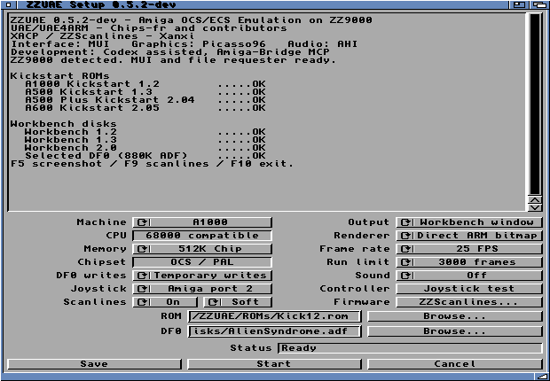

# ZZUAE — Amiga OCS/ECS Emulation on ZZ9000

**0.5.2 Development Beta · Runtime 0.5.2-dev**

Amiga emulation on the ZZ9000 Cortex-A9, with a native AmigaOS MUI launcher.
Based on [Chips-fr/UAE4ARM](https://github.com/Chips-fr/uae4arm-rpi), using
[Xanxi’s XACP framework](https://github.com/Xanxi-Amiga/XACP-ZZ9000) for the
68K/ARM execution model.

## Download and install

[Download the development Beta](https://github.com/SkiltonUSA/ZZUAE-ARM-68K/releases/tag/v0.5.2-beta).
Choose the **AmiPkg LHA** for guided offline installation or the **ZIP** for manual
copying. Extract the installer, open its drawer and double-click **Install**.
Both include Xanxi’s scanline tools; supply your own ROMs and disks.
[Installation and dependency checks](docs/amiga-uae4arm-installer.md).

## Features

- A1000, A500, A500 Plus and A600 profiles, with matching OCS/ECS and memory settings.
- 68000 emulation on Cortex-A9; Copper, Blitter, CIA, floppy and Paula emulation.
- Per-machine Kickstart selection and ADF loading.
- Startup checks for Kickstart and Workbench disks, with OK / MISSING / INVALID status.
- 4:3 Workbench window, up to 640 × 480 and fitted to smaller screens, with an ARM-written Picasso96 bitmap.
- 25, 30, 50 or MAX FPS display choices; audio-paced PAL guest timing when sound is on.
- Paula direct, AHI stereo, or sound Off.
- Keyboard, mouse and Amiga port-2 joystick input; three guest fire buttons.
- Joystick tester, saved settings, startup/error log and cooperative Stop/F10 exit.
- Read-only disks or temporary writes to an in-memory copy.
- F5 screenshot capture to BMP; F9 cycles software scanlines; F10 exits.
- Bundled Xanxi ZZScanlines firmware utility, with an install-missing helper.
- Saved Scanlines On/Off switch with Soft, Smooth and Hard styles for the emulation window.
- Matching colour Workbench icon and opening/loading splash screens with shortcuts.

## Requirements

| Component | Requirement |
|---|---|
| Amiga | AmigaOS 3.x; 68020-compatible host executable |
| ZZ9000 | XX19c/XACP runtime used by this prototype; available application Core1 |
| Memory | 32 MiB available in ZZ9000 RAM for the owned runtime allocation, plus OS/UI headroom |
| Display | Picasso96 and a supported 32-bit RTG Workbench for direct window rendering |
| Launcher | MUI 3.8 or later |
| Joystick | lowlevel.library V40; available buttons depend on controller reports |
| Sound | AHI unit 0 for AHI output; native audio.device for Paula direct |
| Media | Matching Kickstart ROM and Workbench/game disk images supplied separately |

Development has been tested on an A4000TX with TF4060. The TF4060 is the tested
configuration, not a hard-coded requirement; slower host CPUs remain unmeasured.
Only one application may use Core1 at a time.

## Screenshots

Captured on the physical A4000TX/ZZ9000, with native FinalWriter running beside
ZZUAE. Badlands shows its **demo race**; Alien Syndrome shows its **title screen**.
The comparisons use software scanlines inside the game window. Click an image
for the full-size Workbench capture.

| Game | Scanlines Off | Soft scanlines |
|---|---|---|
| Badlands — demo race |  |  |
| Alien Syndrome — title |  |  |

### Startup and loading

| Opening splash | Loading splash |
|---|---|
|  |  |

### Three-button joystick tester

### Workbench 2.0 in the A500 Plus profile

## Optimisation results

Matched 1,800-frame Alien Syndrome startup runs on the A4000TX/ZZ9000,
640 × 480 Direct window, audio Off, scanlines Off and MAX frame rate:

| Build | Mean emulated FPS | Gain over baseline |
|---|---:|---:|
| 0.5.1 baseline | 29.17 | — |
| Batched interpreter exception context | 30.24 | +3.69% |
| Plus cached converted rows and specialised pixel loops (0.5.2) | 44.99 | +54.24% |

Guest instructions, cycles, final PC and frame hash matched. These are uncapped
startup measurements, not gameplay FPS or a promise of full-speed compatibility.
No JIT, NEON or VFP was added. [Method, audio results and validation](docs/amiga-uae4arm-optimisation.md).

## Status

A1000, A500 and A500 Plus boot checks passed on hardware. A600 is model-tested;
Kickstart 2.05 now passes the launcher’s file checks, but A600 boot/game
validation on hardware remains pending. The A1000 profile
uses a preloaded ROM rather than the original disk-bootstrap sequence.

This is a bounded prototype: fullscreen, unlimited play, disk swapping,
persistent disk writes, IDE/PCMCIA media and RTC backends remain unfinished.
Audio queue gaps are still being investigated; listening and physical joystick
acceptance remain pending. With sound Off, current frame caps also slow guest time.
No ARM JIT, NEON or VFP acceleration is enabled in this baseline.

ZZScanlines requires compatible FPGA firmware and a supported low-resolution
mode. High-resolution RTG Workbench is normally unaffected; ZZUAE’s optional
software scanlines work inside its window. Opening the firmware utility does
not automatically alter the display.

## Development

- [Build instructions and implementation](amiga/uae4arm/README.md)
- [Standalone backup/build scope](docs/BUILD.md)
- [Changelog](CHANGELOG.md)
- [Bundled ZZScanlines](amiga/uae4arm/scanlines/README.md)
- [Sound and input](docs/amiga-uae4arm-audio.md)
- [Machine profiles](docs/amiga-uae4arm-profiles.md)
- [Live rendering measurements](docs/amiga-uae4arm-live.md)
- [Initial prototype and SysInfo results](docs/amiga-uae4arm-prototype.md)
- [Verification records](docs/verification/README.md)
- [Credits and licensing](NOTICE.md)

The core is pinned to `fc1cb90afd6b5c6d9bb933d111c4c99c90f37688`.
The shared version lives in `amiga/uae4arm/version.h`.

Development: Codex assisted, Amiga-Bridge MCP.
