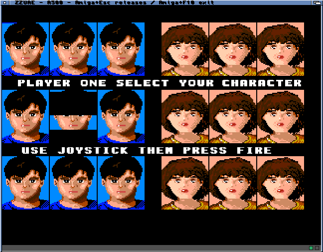

# Window status lights

Two 6×6 lamps sit in a separate 12-pixel strip below the guest picture. Green
means a frame has been displayed and execution has not been stopped. Red uses
the core's DF0 GUI indicator (selected/motor activity, including writing).

The ARM publishes the DF0 state in its own shared status cache line. The host
invalidates that word before reading it and repaints only on a state change or
window refresh, after any direct bitmap lock has been released. Fullscreen and
the guest rendering dimensions remain unchanged. Mouse capture excludes the strip.

The new instruction-model test failed on the previous binary, then passed on
compatible, JIT and optional-FPU builds: disk on, write state, disk off and
unrelated GUI LED isolation. Existing mouse, keyboard, RAM/profile and optional
FPU arithmetic/restoration checks also passed. Cross-builds passed with warnings
as errors. ZIP and signed offline AmiPkg builds were refreshed locally.

Physical SysInfo boot completed 1,800 guest frames and 1,037 presentations.
The green lamp was visible; DF0 switched on/off three times. No input overflow,
runtime failure, register/MMU mismatch or cache witness failure was reported.
The input handler was removed and owned memory released.

## Application-safe shortcuts

Amiga+F10 replaces plain F10 for exit. Amiga+Esc toggles window mouse capture;
plain Esc, F8 and F10 reach the guest. Either Amiga key works. Window titles,
splash help and current instructions were updated; historical test logs remain
unchanged. The host uses one shared key/qualifier predicate for the event loop
and the exit escape route in input.device.

The compiled 68k shortcut check ran on the A4000TX, covering all raw-key values
with no modifier, Control/Alt, left Amiga and right Amiga. Physical capture,
release and recapture passed. Plain Esc/F8/F10 retained capture; Amiga+F10
closed the player with user_exit=1, failed=0, overflow=0, handler removal and
complete restoration. That run delivered 1,768 presentations. Its Alien Syndrome
boot stopped in the guest Shell because the disk was read-only; this is not a
successful gameplay test. The subsequent temporary-write run reached Alien Syndrome's title and character
selection with plain F10, remained captured, then exited with right Amiga+F10.
It completed 2,824 presentations, DF0 on/off five times, zero input overflow,
zero reported runtime/device error and complete restoration. Bringing FinalWriter
forward released capture; its unsaved document remained open. These checks do
not establish audible quality (late queue observations were recorded).

The public release remains unchanged; rebuilt ZIP and signed offline AmiPkg
artifacts are local development packages.

Installed the launcher and all three players with CRC32 verification and rollback
copies. Existing saved settings and Workbench screen preferences were unchanged;
FinalWriter was preserved. The launcher was restarted to show the updated help.
See `install-result.log` for installed executable sizes and checksums.
