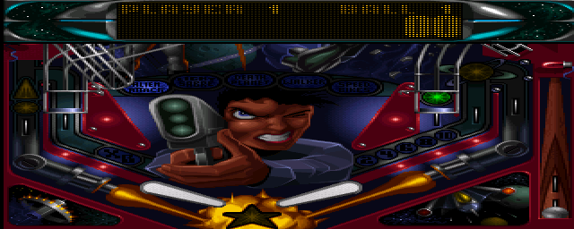

# Wider zero-cycle blitter-service tests

The private shortcut passes correctness checks but shows **no useful Slam Tilt
speed gain**. Keep the installed player unchanged. The repeated Banshee gain of
1.68–1.83% remains a workload-specific result, not a general AGA improvement.

## What changes

The accelerated dispatcher normally calls `do_specialties(0)` after advancing
instruction cycles. With only `SPCFLAG_BLTNASTY` pending, that call performs no
service: its blitter loop requires positive cycles. The candidate skips that
one call and leaves the flag pending. Combined flags, interrupt checks, guest
cycles and scheduled blitter operations retain their original behaviour.

See the [initial investigation and repeated Banshee comparison](BLITTER-SERVICE.md).
This is an unreleased 0.6.0-dev A1200 experiment; it is not included in the
published 0.5.7 Beta.

## Physical comparison

Both builds use PAL A1200/68020 interpretation, 2 MiB Chip RAM, native fullscreen,
Paula output and the same scripted input. External gameplay input is suppressed
in both private test hosts. The extended pair uses identical additional input
to reach the pinball table.

| Slam Tilt sequence | Guest frames per run | Reference FPS | Candidate FPS | Change |
|---|---:|---:|---:|---:|
| Loading and intro | 6,000 | 48.992 | 48.935 | −0.115% |
| Boot through table | 9,000 | 46.691 | 46.704 | +0.027% |

These are whole-run **emulated FPS**, including loading and intro. They are not
the game's internal FPS or an isolated table-gameplay measurement. The intro
is near the pacing ceiling. These small single-pair differences establish
neither a useful gain nor a repeatable regression.

The host's progress counter instead counts displayed frames. The extended runs
presented 4,472 and 4,437 frames respectively; presentation can be skipped by
audio pacing. Do not treat those interval rates as emulated FPS.

## Correctness and audio

- Four ARM instruction-model comparisons of the extended builds match CPU
  state, RAM and pixels across memory, interrupt, beam and Copper-colour tests.
  The Copper test also matches nonempty PCM. Direct handler checks preserve
  BLTNASTY and the register block at zero cycles.
- Each physical pair matches final dispatches, guest cycles, PC, guest hash and
  framebuffer hash. The table pair completes 210,123,260 dispatches and
  1,197,005,707 guest cycles, ending at PC `0003cb56`.
- The intro pair delivers 3,330,048 PCM frames each, but its nonzero-frame count
  is zero. It therefore provides no audible-quality evidence.
- The table pair delivers all 4,995,072 queued PCM frames each, including matching
  counts of 891,716 nonzero frames. Device errors are zero. Late-submit gaps are
  1,252 and 1,283; this is not an audio fix or a listening test.
- All four physical runs pass register/MMU/cache-witness restoration and release
  their allocated memory. Transport and SIMD checks report no failures.

This is the raw internal framebuffer capture. Its SHA256 matches in both builds:
`a218214805297f2395a1d4db3777a3a21e631556e7e4420894484a4cbc826abb`.

## Outcome

This round adds four physical runs and 30,000 guest frames. The candidate remains
private because wider testing has not established a useful general benefit.
There is no new default, firmware change or release. Temporary test players were
removed, Core1 is free, and installed normal/A1200/FPU hashes remain unchanged.

Further work should target measured CPU/chipset execution cost and PCM production.
The frequent empty service calls must not be confused with expensive blitter
arithmetic or used to justify skipping guest DMA timing.

[Evidence](blitter-wider/) includes build hashes, model comparisons, physical
logs, captures, result tables and cleanup checks. ROMs and disk images are excluded.
