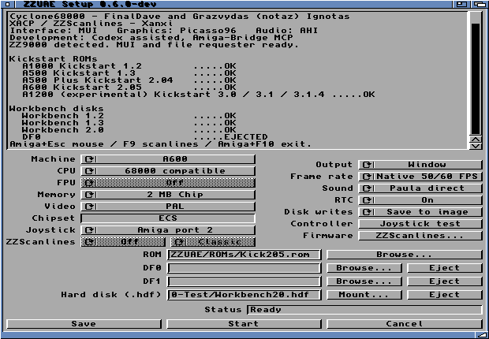
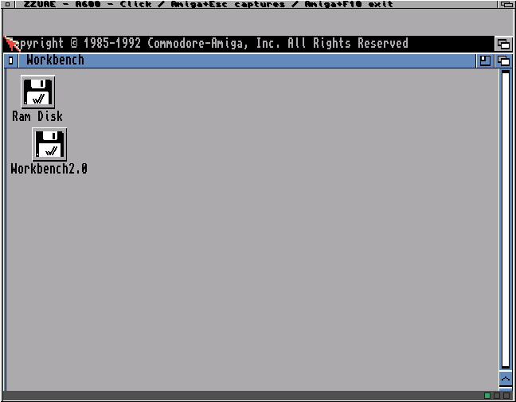

# A600 ECS hard-disk validation

The 0.6.0 development launcher exposes the existing IDE backend through
**Hard disk (.hdf) → Mount…** and checks the image before starting Core1.
The published 0.5.7 Beta release is unchanged.

## Physical results

Tested on the A4000TX / ZZ9000 with the compatible 68000 engine, A600 ECS,
2 MiB Chip RAM, PAL, Kickstart 2.05 revision 37.350 and a private 4 MiB RDB/FFS
image containing Workbench 2.0. DF0 and DF1 were empty. Audio was disabled
for these storage tests.

| Test | Result |
| --- | --- |
| Writable boot, 1,800 frames | 187 storage reads, 7 writes, 0 errors |
| Guest-created file | Read back `ZZUAE-HDF-Test.txt` and verified its contents |
| Read-only reboot, 2,400 frames | 187 reads, 0 writes, 0 errors; image MD5 unchanged |
| Shutdown | Both runs exited successfully and released the Core1 allocation |

The guest file contained `ZZUAE A600 HDF guest write passed`. The read-only
image digest before and after the second run was
`e3d5e87002bb837b5f88237967483c13`. The writable run also reported zero pixel
SIMD mismatches, register mismatches and cache-witness errors.
These boot/I/O runs are not gameplay performance or audio acceptance tests.

Native sanitizer tests passed for image preflight and launcher command generation.
Existing storage tests passed for changed-block writes, journal recovery and bounds.
The m68k launcher built with warnings treated as errors.

## Scope

This validates A600 hard-disk boot, persistent writes and read-only operation.
It does not validate the supplied 9.6 GiB AmigaVision main image, which exceeds
the current backend limit. A500/Kickstart 1.3 controller emulation remains absent.
See [image requirements and AmigaVision guidance](../../HARD-DISKS.md).
ROMs and Workbench disk content are not included here.
