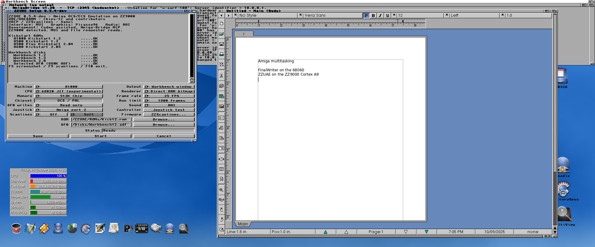
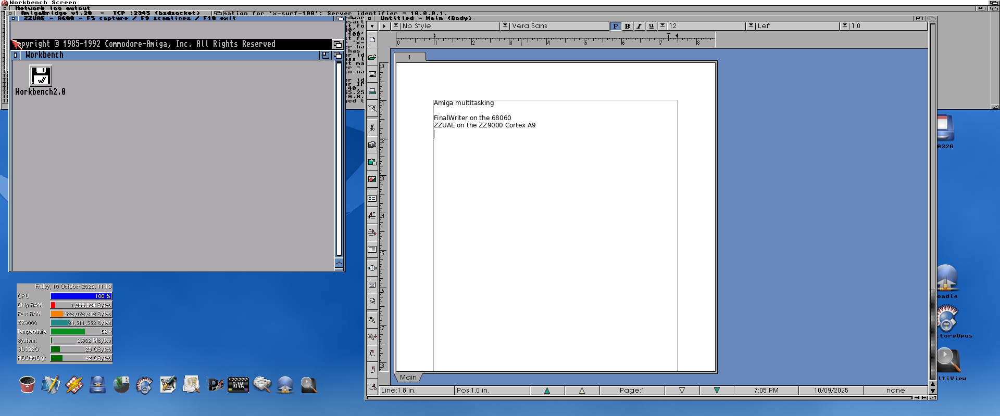

# ZZUAE experimental guest-JIT player

This work integrates the UAE4ARM guest translator with ZZUAE's chipset,
interrupts, display and audio. The normal player remains a compatible 68000
interpreter. The experimental player uses a **68020 guest CPU**, with either
translated blocks or a matching interpreter for comparison; it is not a
cycle-accurate A500 replacement.

## Correctness before speed

A three-frame synthetic machine test compares CPU registers, flags, PC, Chip RAM,
pixels, PCM, emulated cycles and frame count. Matching scheduler/cache preferences
are required: merely selecting the same ROM does not make two engines comparable.
A JIT dispatch can execute several guest instructions, so the diagnostic labels
its count as dispatches rather than instructions.

The first physical A600 boot completed 300 frames. Alien Syndrome then exposed
a guest failure that the CPU-only tests had missed. The matching 68020 interpreter
completed 1,800 frames. All these physical runs returned to Workbench with host
restoration; the failed JIT run is retained as a failure, not a performance result.

The failure reproduced in the instruction model at frame 58 of Kickstart 1.2
boot. Opcode-family bisection narrowed it to byte moves into data registers.
A new mixed byte-move fixture failed comparison 222, with D2–D5 mismatches.
Four ARMv6 fallback paths in the pinned upstream translator prepared WORK1 but
merged WORK2 into the destination. The port corrects those paths to merge WORK1.
This preserves the upper 24 bits of the 68K data register.

A separate test found stale translated RAM code when a guest modified an immediate
without explicitly flushing its cache. The player checks the mutable entry block's
checksum before dispatch; ROM blocks retain upstream's immutable treatment.
Linked-block execution is disabled. This does not establish support for every
self-modifying-code pattern, particularly modification inside a running block.

## Execution contract

- Private, owned 512 KiB executable cache with A9 instruction publication and
  permission restoration; no Linux memory services or static DDR allocation.
- All guest memory accesses use UAE banks, including bulk instruction paths.
- Bounded traces and event/interrupt servicing between dispatches.
- Integer division falls back to the interpreter; this base JIT player keeps guest FPU disabled. The separate [ZZUAE-FPU player](amiga-uae4arm-fpu.md) adds optional VFP-backed 68882 emulation.
- Separate experimental executable; the compatible player remains available.
- Shared allocation, mapping probe, Core1 ownership and teardown follow the
  existing XACP launcher contract.

## Validation status

The corrected byte fixture passes all 240 comparisons at three model allocation
addresses. The previously failing 100-frame Kickstart 1.2 boot now passes without
opcode filtering. Synthetic CPU/CCR, RAM, pixels, PCM, cycles and frames match
between the two engines.

The physical JIT player completes the 1,800-frame Alien Syndrome startup run,
with final picture hash `39f1fa80`, no SIMD errors, full register/MMU/cache
restoration and owned-memory release. No downloadable JIT release is claimed.

## Measured performance

Matched 1,800-frame Alien Syndrome startup runs on the physical ZZ9000, same
68020 CPU configuration, media, memory, MAX rate and audio Off:

| Presentation | 68020 interpreter | 68020 JIT | Throughput change |
|---|---:|---:|---:|
| Direct 640 × 480 window, Soft scanlines | 36.732 s / 49.00 emulated FPS | 36.914 s / 48.76 emulated FPS | −0.49% |
| No live window | 26.100 s / 68.97 emulated FPS | 26.076 s / 69.03 emulated FPS | +0.09% |

These single paired runs show **no meaningful speedup**. They are startup
throughput, not sustained gameplay FPS. Both engines end at PC `00fc0cd0` with
picture hash `39f1fa80`; the final emulated cycle count differs by three cycles
at the frame boundary. The synthetic differential test has exact cycle equality.

JIT reduces dispatches from 12,420,643 to 4,825,035, but a dispatch is a different
unit when it can execute a block. This is not a 61% performance gain. Compilation,
validation, chipset emulation and rendering remain in the measured workload;
separate profiling is needed to attribute their costs. Removing live presentation
helps both engines similarly, so display work alone does not explain the tie.

A physical AHI/F10 lifecycle check delivered 1,437,696 PCM frames with no device
errors and restored the machine on exit. This early intro was silent; it does
not establish audible quality. Both engines also completed a longer 6,000-frame run with non-silent audio and
clean restoration:

| AHI / 25 FPS display limit | 68020 interpreter | 68020 JIT |
|---|---:|---:|
| Elapsed time | 128.232 s | 129.353 s |
| Delivered PCM frames | 3,845,120 | 3,845,120 |
| Nonzero PCM frames | 2,249,081 | 2,262,543 |
| Late queue observations | 864 | 1,011 |
| Display updates deferred | 1,353 | 1,427 |

Device errors were zero, but **this is not an audio-stability pass**. Late queue
observations are not dropout durations. Final PCs/picture hashes and nonzero PCM
counts differed between the engines, so the longer game run is not an exact
state-equivalence pass either. Block/event timing and audio pacing need further
investigation. Retain the compatible 68000 player for normal use; experimental
68020 modes are for development. Listening acceptance remains pending.

The A600/Kickstart 37.350/Workbench 2.0 test reached the desktop and completed
1,800 frames with clean restoration. A concurrent screenshot blocked the bridge
poll long enough to time out the Mac driver; the completed player log was pulled
separately. That run is excluded from timing comparisons.

## Development method

The requested [UB-mode](https://github.com/unclebob/ub-mode) workflow was applied:
reproduce failures, add focused behavioral tests, correct their causes, then
measure. Its Python companion tools do not analyse the emulator's C/C++ or ARM
assembly. Complexity-only and duplicate scans were run on the build adapter;
the mutation tool only inventoried sites. These are not coverage or mutation-pass
claims. Emulator validation uses native tests, actual generated ARM code in the
instruction model, and separate physical ZZ9000 runs.

## Build and launcher

After the normal core/toolchain preparation:

```sh
python3 scripts/build_uae4arm_jit.py --player --hardware
python3 tests/amiga/uae4arm/jit_guest.py --mmu
python3 scripts/build_uae4arm_launcher.py
```

The isolated player is built at
`.context/amiga/uae4arm/jit-execution/machine/ZZUAEBoot`; install it beside the
launcher as **ZZUAE-JIT**. Keep **ZZUAE-Player**, the compatible interpreter, in
place. This development build is not included in the 0.5.3 download.

The CPU selector chooses the executable and records `engine=0/1/2` when settings
are explicitly saved. Older preference files default to the compatible engine.
No automatic migration changes the saved CPU choice. The test interpreter uses
the same 68020 scheduler/table settings as JIT while dispatching individual
instructions. F10/Stop and existing display/audio choices use the normal launcher
and transport lifecycle.


## Installed development check

The matched launcher and separate JIT executable are installed on the test Amiga.
The CPU selector was exercised through MUI, started engine 1, and exited through
F10 after 680 guest frames. The physical log confirms clean host restoration and
memory release. The launcher was reopened with the unchanged saved 68000 default.
The existing compatible executable and media were preserved; the previous launcher
is retained for rollback. No new release package was published.

## Evidence

[Selected physical/model logs and artifact hashes](../amiga/records/2026-10-27/uae4arm/jit-player/)
include the failed pre-fix game run and the longer audio limitations.




