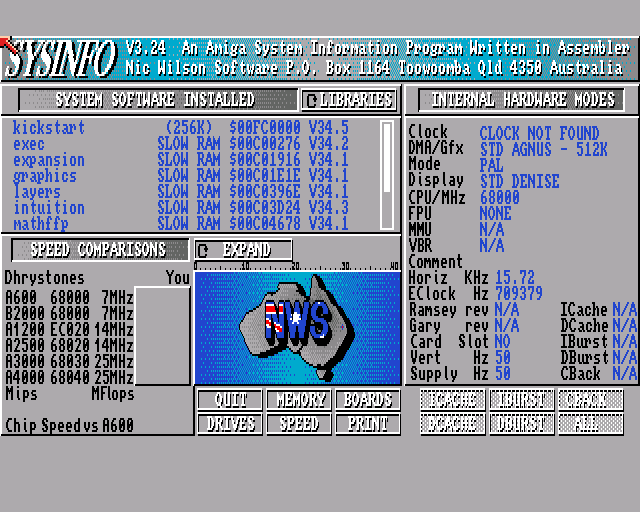
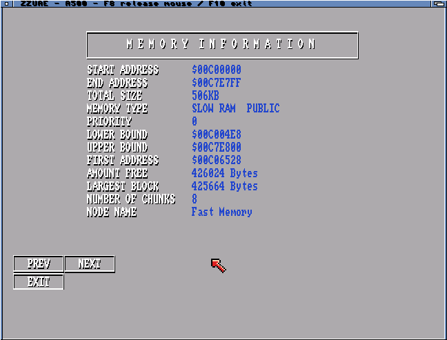

# ZZUAE mouse input repair

Mouse input is always available in the emulated Amiga's first controller port.
The optional joystick uses the second port. In a window, **click inside to capture
the mouse**; that first click only activates capture. The native pointer is
hidden and stays parked while the guest receives relative movement and clicks.
**F8 releases** it to Workbench; click again to recapture. Fullscreen receives
mouse input directly. **F10 exits** in either mode.

ZZDosBox can deliver absolute coordinates to its guest mouse driver. This port
currently drives Amiga mouse counters, so the window instead uses relative
capture, avoiding two drifting pointers and clicks outside the window.

The native input.device handler only queues mouse reports in host memory. The
main task drains them to the existing ARM input mailbox, retaining ordered
button transitions and applying backpressure. F8/F10 releases capture in the
input handler itself even if the main task is awaiting a frame; focus loss and
queue overflow also release it. Shutdown removes the handler before freeing
resources. [AmigaOS input handler interface](https://wiki.amigaos.net/wiki/Input_Device).

## Cause and correction

The custom platform called UAE's horizontal input service but omitted its
vertical input timing. `readinput()` compares the current scanline plus the
input-frame counter with the previous sample. Without advancing that counter,
sampling stalls across frames and movement accumulates without reaching JOY0DAT.
The previous tests covered buttons and keys but did not check mouse counters.

The new platform hook advances `input_frame` and runs `mouseupdate(0, true)`
once per guest frame, matching the timing portion of upstream
`inputdevice_vsync()`. Host-device discovery/configuration stays outside the
bare-metal worker; events already arrive through the shared input queue.

The host also used differences between absolute pointer coordinates, which
stopped producing movement at screen edges. It now requests IDCMP_DELTAMOVE and
forwards raw relative X/Y values, with consistent sensitivity across display
sizes. Intuition documents that these events continue beyond display edges;
its mouse queue is increased to 32. Focus loss still releases guest buttons
and keys. [AmigaOS input documentation](https://wiki.amigaos.net/wiki/Intuition_Input_and_Output_Methods).

## Verification

The added instruction-model regression first failed: injected (+12, -7)
movement left JOY0DAT unchanged at zero. It now passes successive positive and
negative movements across guest frames and 8-bit counter wrap. Existing button,
keyboard, joystick and focus-loss checks also pass. Direct-render tests retain
correct pixels, bounds, cancellation, mapping teardown and NEON register state.

The physical compatible-player SysInfo run received 1,038 input events and
exited with F10, no queue overflow or runtime failure, and complete register,
MMU/cache and allocation cleanup. The user confirmed mouse movement and buttons.
A separate Workbench-window run showed guest pointer movement after activating
the window. The user also confirmed working movement/buttons, then reported awkward
window interaction; this led to the capture control above. Physical HiRes
640×512 SysInfo boot, screenshot, F10 and complete cleanup passed.

## Text resolution

The game-oriented PAL output is 320×256. Reducing the core's 640×256 image to
this width discards alternate horizontal samples, including details in HiRes
fonts. A 640×480 window keeps the horizontal samples, but its noninteger vertical
scaling produces uneven row heights.

The new **Fullscreen HiRes** selection opens a temporary 640×512, 32-bit RTG
screen. It keeps all horizontal samples and doubles each source row exactly.
This is an output option, not added guest interlace support; guest rendering
remains 640×256. The installed RTG mode must exist. PAL 320×256 remains available
for games and existing settings keep their meaning. Xanxi FPGA scanlines and
F9 cycling remain limited to the low-resolution fullscreen mode.

Native configuration/mapping checks and actual ARM conversion tests cover both
pixel formats, 640×512 row padding and bounds, shared-buffer ownership rejection,
cancellation, mapping teardown and NEON register preservation. JIT and optional
FPU builds also pass the input-counter regression.

No Workbench screen preferences or saved emulator settings are changed.

## Capture acceptance on the physical Amiga

The compatible player booted SysInfo 3.24 in a Workbench window. A click captured
the mouse and changed the title to F8 release. Relative movements reached the
guest while the native pointer stayed at its parked screen location. A captured
left click opened SysInfo's Memory page. F8 released the pointer; recapture,
focus-loss release and F10 exit were checked. The input handler was removed at
shutdown, both input rings reported zero overflow, and register/MMU/cache checks
and allocation release passed (7,476 display updates over 263.4 seconds).

The separate HiRes run completed 1,345 display updates and clean F10 teardown.
These are interaction and lifecycle tests, not new FPS benchmark claims. JIT/FPU
use the same host capture implementation and pass model input/lifecycle checks;
this turn's physical capture check used the compatible player.

The local ZIP and signed offline AmiPkg installer were rebuilt with all three
players and the updated launcher. The public release remains 0.5.3 Beta.

[Selected hardware logs and build identities](../amiga/records/2026-10-27/uae4arm/mouse-hires/).

## Captures

