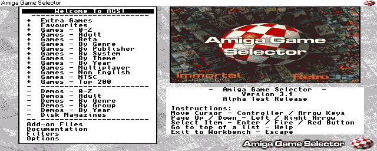

# AGS physical USB boot on A1200

Initial USB candidate tests; public **0.6.3 Beta** remains unchanged.
The later [model-memory candidate](../model-memory/README.md) is now installed.

After the Amiga reboot, Poseidon exposes the AGS card as `USBSD:2`. Its RDB
header validates and capacity is 62,333,952 sectors of 512 bytes. The earlier
missing-card result was a host enumeration failure, before guest startup.

The A1200 68020 interpreter boots AGS Classic ECS to its main menu from this
card. Paula and AHI runs each complete 3,000 guest frames, 770 USB reads, zero writes
and zero storage errors. All submitted audio samples complete, and register,
MMU/cache witnesses and owned-memory release pass. The retained clock is
800 MHz KEEP.

Raw 640×256 guest capture; the Workbench window applies 4:3 presentation.
This is selector boot coverage, not acceptance of every WHDLoad game.

## Launcher

The development launcher allows **USB SD** with A600's compatible or 68020
interpreter, or A1200's 68020 interpreter. Select FPU off and Read only.
Eject DF0/DF1 to boot the card. The launcher locates the USB unit through
Workbench's device list; the card must first be visible to Poseidon.

Settings validation also rejects physical USB writes, JIT, Cyclone, FPU and
incompatible machine selections. The image-backed PCMCIA option is separate.
The paired candidate and launcher are not substituted into the 0.6.3 installer.

## Audio investigation

| Setup | Guest frames | USB reads | Non-zero PCM frames | Queue gaps |
|---|---:|---:|---:|---:|
| A1200, 2 MiB Chip, Paula | 3,000 | 770 | 0 | 205 |
| A1200, 2 MiB Chip, AHI unit 0 | 3,000 | 770 | 0 | 191 |
| A1200, 2 MiB Chip, Paula, longer run | 6,000 | 770 | 0 | 195 |
| A600, 2 MiB Chip + 8 MiB Fast, Paula | 3,000 | 836 | 296,291 | 31 |
| A600, 2 MiB Chip, Paula | 3,000 | 778 | 0 | 5 |
| A600, 1 MiB Chip, Paula | 3,000 | 193 | 0 | 1 |

All runs have zero storage writes/errors and clean teardown. The A1200
runs validate delivery/cleanup of a silent stream, not AGS music. Extending
the run to 6,000 frames did not produce audio. The A600 Fast RAM setup reaches
the selector and produces audio; its low-memory control remains on a blank
screen. These different memory/model configurations are not a performance
comparison. Queue-gap counts from silent runs must not be used to claim an
audio improvement.

A600 with 2 MiB Chip and no Fast RAM also reaches the selector but produces
no audio. This supports investigating memory availability; it does not by
itself identify AGS's internal music-loading decision.
Hands-on controller and listening acceptance remain pending. A subsequent model-memory candidate adds Fast RAM choices; see
[model configuration tests](../model-memory/README.md).

## Reproduction

The command files and complete player logs are stored alongside this report.
`player-build.json` records the retained ARM base and candidate inputs;
`launcher-build.json` records the separately built launcher and source hashes.
The launcher configuration test passes with AddressSanitizer and
UndefinedBehaviorSanitizer. The 68k launcher builds with warnings treated as
errors. None of these checks constitutes audible-quality approval.

One initial 2 MiB A600 control was excluded: its log contained only the
completion marker. Core1 was idle afterward, but the result lacked teardown
evidence. The repeat uses short, separate log and marker names.
