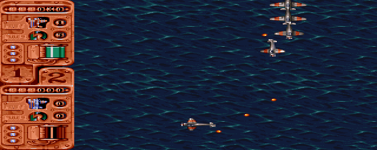

# Full FPU-player clock scaling

The development FPU player now uses the same stock/800 MHz timer conversion as
the normal ZZUAE player. The host measures the CPU/2 timer, publishes 333 or 400
ticks per microsecond, and rejects unsupported rates before guest execution.
The ARM side uses that divisor for pacing and RTC time. This does not change the
PLL, guest CPU clock, PAL/NTSC chipset timing or FPU arithmetic implementation.

The former player rejected 800 MHz. Simply removing that check would be wrong:
the original ARM function counted 400,000,000 timer ticks as **1,201,201 us**
instead of 1,000,000 us. The regression reproduces that error; the new function
passes at both supported divisors, across the 32-bit timer rollover and at a
24-hour uptime. Stock 666.7 MHz retains the existing 333-tick conversion.

The build retains the recorded guest CPU, chipset, JIT and VFP backend objects,
refreshes the platform adapter and host, and keeps the paired MMU layout files.
It preserves the 32 MiB executable cache and 72 MiB host allocation. Product
version is 0.6.1-dev; the retained core base is identified separately as
0.6.0-dev. A nonzero VFP-state mismatch now fails the host result explicitly.

## Validation

- Native clock conversion: supported/rejected rates, bounds and long uptime.
- Actual ARM clock function: both divisors, including timer rollover.
- Four ARM-model guest tests: interpreter/JIT × stock/800 MHz timer, arithmetic,
  rounding, extended-format stores and complete VFP restoration.
- Eight ARM-model lifecycle cases: arithmetic, success, cancellation, invalid
  options, cleanup abort, rejected vectors, unlimited cancellation and unavailable VFP.
- Physical arithmetic at 800 MHz: 576 FPU instructions, 288 data operations,
  24 FSAVE/FRESTORE rounds, zero VFP-state mismatch, clean teardown.
- Full player: PAL interpreter/JIT and NTSC interpreter boot tests with Paula.
- Banshee gameplay: 6,000 frames with test-only fire/movement input, no FPU-state
  mismatch and clean teardown. The normal player has no scripted input.
- Frontier intro, Alien Syndrome character selection and Amiga+F10 cancellation.

[Hardware results and exact coverage](hardware.json) · [Build identities](build.json) ·
[Arithmetic log](arithmetic-hardware.txt) · [Lifecycle checks](lifecycle.txt).
Captures are raw guest frames, not screenshots of the display's aspect correction.
The first Alien Syndrome run stopped in its startup script on a write-protected
disk; the corrected run uses temporary disk writes and reaches character selection.
The source disk is unchanged. Banshee's initial 4,000-frame capture is its
high-score screen; it is not labelled gameplay. The separate 6,000-frame
diagnostic reached gameplay and completed in 141.12 seconds (42.52 emulated
frames/s, 3,094 presented frames). This is a compatibility result, not a matched
performance comparison. [Diagnostic build identity](gameplay-build.json).



## Limits

Physical tests retain the requested **800 MHz** setting. Stock-clock coverage in
this round is instruction-model testing; the physical clock was not lowered.
All reported passing runs restore register/cache witnesses and release memory.
Audio samples were submitted and completed without a device error, but Banshee
and Frontier still report queue gaps. Counts do not establish audible duration
or subjective quality. This work does not solve those performance limits or
establish an FPS gain against the released player.

The games observed here perform no FPU data arithmetic. Their FPU save/restore
activity checks compatibility with AmigaOS, not floating-point acceleration.
The separate arithmetic fixture exercises actual FPU calculations. The backend
still uses double precision; full 80-bit accuracy, every exception and arbitrary
FPU software compatibility are outside this validation. FPU remains optional,
experimental and off by default. JIT remains experimental.

## Installed development build

The normal `ZZUAE-FPU` was installed after backing up the previous player.
An additional 120-frame A600 interpreter/FPU boot with Paula passed from the
installed path, with clean teardown. [Installed identity](installed.json).
The launcher, saved settings, normal players and firmware were unchanged.
The downloadable 0.6.1 Beta archives still contain the earlier FPU player;
this development update will require inclusion in the next release.

## Reproduce

Use a prepared workspace and the recorded FPU core directory:

```sh
python3 scripts/build_fpu_clock.py --workspace /path/to/prepared/workspace \
  --base /path/to/recorded/fpu-execution --output /path/to/isolated/output
python3 tests/amiga/uae4arm/check_clock.py /path/to/output/uae-machine.elf
```

The builder expects the workspace toolchain described in [the build guide](../../build.md).
It never flashes firmware, changes clocks, deploys files or overwrites its base.
`--gameplay-test` generates a separate diagnostic with Banshee mouse/fire/movement
at fixed guest frames, enabled by the existing `LMB` test argument. **Do not
install that variant.** Normal builds have no automatic game input.
