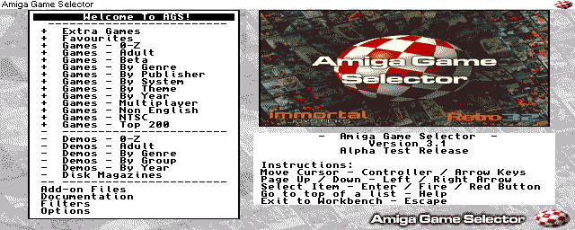

# Model configuration and Fast RAM

Development candidate installed in the main ZZUAE drawer after the tests below.
Public 0.6.3 Beta and its AmiPkg are unchanged; this is not a new public release.

The launcher offers 2, 4 and 8 MiB Fast RAM on A1000, A500, A500 Plus,
A600 and A1200. It uses the existing Zorro-II autoconfig bank. Guest Chip
and Slow RAM remain model-specific:

| Model | RAM alongside the selected Fast RAM |
|---|---|
| A1000 | 512 KiB Chip |
| A500 | 512 KiB Chip + 512 KiB Slow |
| A500 Plus | 2 MiB Chip |
| A600 | 2 MiB Chip |
| A1200 | 2 MiB Chip |

Choose the 68000 compatible or 68020 interpreter with FPU off. A1200 requires
68020. JIT/Cyclone/FPU combinations with Fast RAM remain rejected rather than
silently ignoring the selection. Existing saved RAM values retain their meaning;
A1200 shows a single standard Chip RAM choice.

Paula/AHI, PCM rates, PAL/NTSC, window/fullscreen, USB/gameport controls, RTC,
DF0/DF1 and floppy write settings are shared across models. IDE HDF, physical
USB SD and PCMCIA remain on A600/A1200: the earlier profiles do not emulate
those controllers. Physical USB is read only; PCMCIA is image-backed and needs
guest drivers. Scanlines still depend on the supported fullscreen mode.

Native sanitizer tests cover memory-size settings, persisted configurations,
command generation, model Chip/Slow RAM layouts and rejection of unsupported
CPU/FPU combinations. Both retained interpreter builds reproduce their original
ARM payload before substituting the updated machine-profile object. The build
manifests record that object and its source; the hardware records identify the corresponding tested binaries.

## Diagnostic correction

The first A500 test configured the 8 MiB bank but reported zero verified Exec
memory. The diagnostic followed memory-list nodes only in Chip/Fast RAM and
missed nodes in A500 Slow RAM. It now checks bounded Chip, Slow and Fast RAM
spans, and counts only the expansion's address range. The repeated A500 run
reports 8,388,576 usable bytes, matching the other profiles. This is a reporting
fix; it does not change CPU, bus or chipset timing.

## Physical results

At 800 MHz KEEP, all five profiles register 8,388,576 usable bytes from the
8 MiB expansion. A1000, A500, A500 Plus and A600 complete 1,000 guest frames
with the compatible interpreter. A1200 completes 3,000 frames with the 68020
interpreter and AGS on physical USB SD. All runs return zero, restore the
register/MMU/cache witnesses and release their allocations.

The A1200 AGS run completes 828 reads, zero writes and zero storage errors.
It generates 664,327 non-zero PCM frames; without Fast RAM the earlier runs
produced none. All 1,323,008 queued samples complete, with device error zero.
There are still 233 reported queue gaps, so this is audio generation and
cleanup validation, not a claim of uninterrupted playback or listening approval.

The raw guest capture is 640×256; the live window applies 4:3 presentation.
The tests establish configuration/autoconfig and AGS selector coverage, not
compatibility with every game or expansion combination. The 2/4 MiB selectors
and autoconfig descriptors pass native tests; this hardware pass uses 8 MiB.

## Installation

The launcher and both interpreter-capable players were installed together and
checked by hash. `installation.json` records the files and rollback location.
FPU and Cyclone players are retained; Fast RAM remains unavailable with those
engines. No ROMs, media or saved preferences were replaced. The ordinary
launcher opens with the updated choices; this does not select extra RAM
silently when loading existing preferences.
