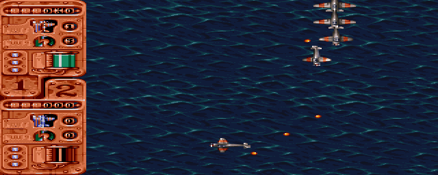

# In-session disk-change candidate

The published release remains **0.6.3 Beta**. These isolated compatible-68000 and
accelerated-player candidates add DF0/DF1 controls to **Amiga+Esc**. Installed
production players and interpreter defaults are unchanged. Subsequent paired
FPU/Cyclone integration and writable-image checks are recorded in the
[storage compatibility follow-up](../storage-compatibility/README.md).

## Behaviour

- Select DF0 or DF1 to choose a standard 880 KiB ADF; each row shows its filename.
- Eject either drive without restarting the emulator. An initially absent DF1
  can be enabled, although guest software may need to mount or discover it.
- Missing, invalid or already-open images leave the current disk attached.
- A selected drive with active DMA, or a drive with unfinished writes, refuses
  the change. Resume before retrying. Activity on another drive does not block it.
- Existing read-only, temporary-write and journalled-write settings are retained.
  Temporary changes are discarded when their in-memory image is ejected.
- Image preparation and any journal recovery finish before the old disk is
  ejected. A failed command acknowledgement stops the player cooperatively.

The host and ARM exchange a sequenced request/reply in separate control cache
lines. ARM commands run only at the existing ungranted-frame checkpoint. The
host waits for EJECT acknowledgement before replacing staged bytes or the
backing-file record. INSERT uses UAE's drive/change machinery and its guest-time
change delay; it does not reset the CPU or redirect a live DMA transfer.

## Validation

Native sanitizer tests exercise preparation failures, DMA refusal, same-image
reinsertion, commit/eject ordering and retained write policy. Linked ARM tests
exercise command validation, selected-drive DMA read/write refusal, changing an
unused drive during another drive's DMA, DF0 replacement, initially absent DF1,
and delayed loading of both image byte patterns. Compatible 68000 and accelerated
JIT configurations pass. The latter records executed translated sites; an earlier
simple ROM fixture did not translate and was not counted as a JIT pass.

On the physical Amiga, the compatible candidate passes real ASL file selection,
DF1 insertion and repeated same-image reinsertion, DF0 replacement, missing-file rejection, rejection of a disk
already attached to DF1, eject/reinsert and clean Amiga+F10 exit. Register/cache
witnesses match and owned memory is released. DF1 insertion acknowledgement is
not proof that Workbench automatically discovers a drive absent at boot.

The new guest self-modifying-code fixture also passes with the accelerated
interpreter and JIT: it warms a routine with 1,024 calls, patches its immediate
byte, then replaces its instruction word. It checks all three results without a
host-side flush. Cyclone's existing MOVEM relocation/exception regression passes
in the ARM instruction model; physical Cyclone testing was not performed at
800 MHz because that player retains its stock-clock restriction.

The released 0.6.3 FPU payload also passes A1200 interpreter/JIT arithmetic,
square-root, rounding, extended-format storage and VFP-state restoration tests.
Extended-format storage does not establish extended-precision arithmetic.
These are instruction-model checks; prior physical FPU gameplay is recorded in
[the FPU clock investigation](../fpu-clock/README.md).

## Limits before promotion

- Broaden interrupted-write recovery scenarios. Guest write/swap/reinsert passes
  in the linked follow-up.
- Test actual multi-disk game prompts and additional guest operating systems.
- Promote the paired FPU/Cyclone candidates after broader gameplay coverage.
- Audio queue accounting is not listening approval. No performance gain is claimed.
- The follow-up adds an experimental PCMCIA CF image adapter. Full 68882
  extended precision remains unimplemented.

The guard initially blocked all DMA activity, including DF0 activity during a
DF1 change. It now checks the affected drive. Early input scripts also inserted
an extra character through an incorrect ASL shortcut and used the wrong key to
acknowledge an Intuition requester; those attempts are not passing UI evidence.

## Reproduce

Use `scripts/build_retained_cadence.py --disk-swap` with the recorded compatible
or accelerated base, released player and a new output directory. The builder
verifies the retained payload, recompiles the prepared disk source with the
small integration hook, and records source/toolchain/artifact hashes. The
recompiled disk object is not claimed to be byte-identical to the old compiler's
object. Never mix the new host with a retained ARM payload.

Run `check_machine.py` with `--synthetic-rom --live --disk-swap` for at least
105 guest frames. For the accelerated player, use its 72 MiB allocation,
`--profile 4 --engine 1 --timing-fixture groups`. Run `--smc-fixture` with
`--engine 1` and `--engine 2` separately. Native transaction and menu tests live
in `tests/amiga/uae4arm/`. For example, from the repository root:

```sh
clang -std=c99 -Wall -Wextra -Werror -fsanitize=address,undefined \
  -Iamiga/uae4arm tests/amiga/uae4arm/disk_swap_storage.c -o /tmp/zzuae-swap-test
/tmp/zzuae-swap-test
python3 tests/amiga/uae4arm/check_machine.py 12 \
  --elf /path/to/accelerated-checked/uae.elf --allocation-mib 72 \
  --profile 4 --engine 1 --synthetic-rom --smc-fixture --neon
```

Use the Python environment containing Unicorn for the linked ARM checks. Repeat
the last command with `--engine 2` for the interpreter. These tests never access
physical hardware.


## Physical audio and gameplay checks

Tests used 800 MHz KEEP, a 640×480 Workbench window, Paula or AHI at 22 kHz
(requested 22,050 Hz; Paula actually 22,030 Hz), and Banshee's playable demo.
No listener was available. Game media and ROMs are not included in these records.

| Test | Guest frames | Result | Queue gaps |
|---|---:|---|---:|
| PAL, Paula, interpreter, boot/intro | 1,800 | Delivery and clean exit pass | 1 |
| PAL, AHI, interpreter, boot/intro | 1,800 | Delivery and clean exit pass | 1 |
| NTSC, Paula, interpreter, boot/intro | 1,800 | Delivery and clean exit pass | 1 |
| PAL, Paula, interpreter, scripted gameplay | 6,000 | Gameplay reached; clean exit | 1,060 |
| PAL, Paula, JIT, original diagnostic budget | Incomplete | 150-second timeout; clean teardown | 1,576 |
| PAL, Paula, JIT, longer diagnostic budget | 6,000 | Gameplay reached; clean exit | 1,834 |

Intro checks deliberately pause/resume and do not establish uninterrupted audio.
All completed/submitted sample counts match, with no device error. Queue gaps
remain a real limitation; counts are not an audible duration or quality score.
The interpreter gameplay run took 136.95 seconds for 6,000 emulated frames,
with 2,308 frames presented under a 30 FPS display cap. Emulated frame rate,
presentation rate and game-internal animation rate are different quantities.
The JIT retry completed the same 6,000 guest frames in 174.27 seconds, presenting
1,516 frames and executing 63,966 translated sites. Its final guest-frame bytes,
diagnostic hash and final PC match the interpreter. These are bounded compatibility
checks, not complete gameplay acceptance. No speed improvement is claimed.
Interpreter remains the default.



Raw 640×256 guest capture; the Workbench window applies aspect correction.

The longer gameplay diagnostic uses identical generated ARM source, with a
300-second host deadline instead of 150 seconds. Its embedded `__FILE__` build
path changes the object layout, so ELF hashes differ. It is a compatibility
retry, not a matched optimisation benchmark. Normal player deadlines are unchanged.
The original failed run did not generate a new capture; a stale RAM capture
was excluded from the evidence.

`--gameplay-test` produces **ZZUAE-GameTest**, refuses unlimited/normal startup,
and scripts mouse/fire/movement only with the existing `LMB` test argument.
Never install it as a player. The first diagnostic predates the separate output
name; its build hash is retained for traceability. Use a fresh output directory
for each build and unique hardware log names.

The current USB probe could not open the configured `USBSD:2` RDB device and
returned 20 cleanly. This does not establish whether the card is absent, on a
different unit, or otherwise unavailable. No A1200 raw-card run was counted and
no physical write was attempted. Existing native USB completion/timeout tests
pass; they do not prove hardware media compatibility.

[Build identities](builds.json) and [test logs](logs/) retain passing and failed
results separately. The normal checked candidates are `compatible-checked` and
`accelerated-checked`; initial UI evidence used `compatible-r3`, intro/audio
checks used `accelerated-final`, and gameplay used the explicitly labelled
diagnostics. The final repeated DF1 sequence uses `compatible-checked`.

The normal checked builds precede the final diagnostic-only builder additions;
their recorded runtime source hashes still match. The builder hash is retained
per build rather than silently replaced with the later version.
